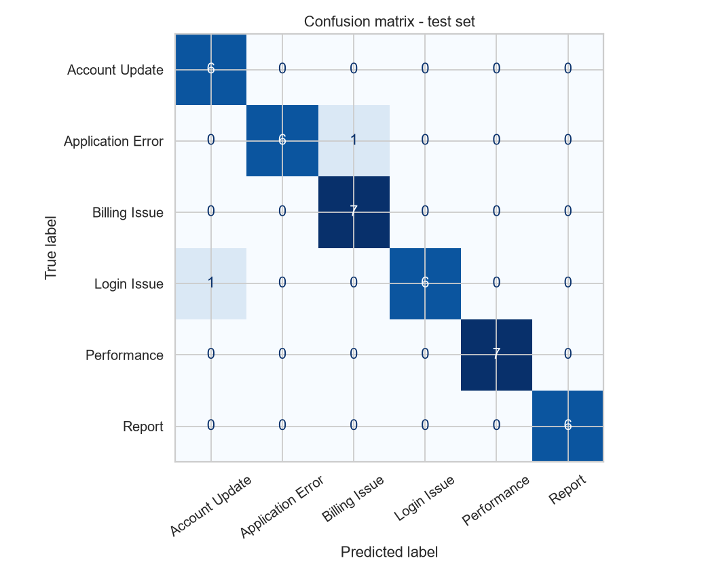
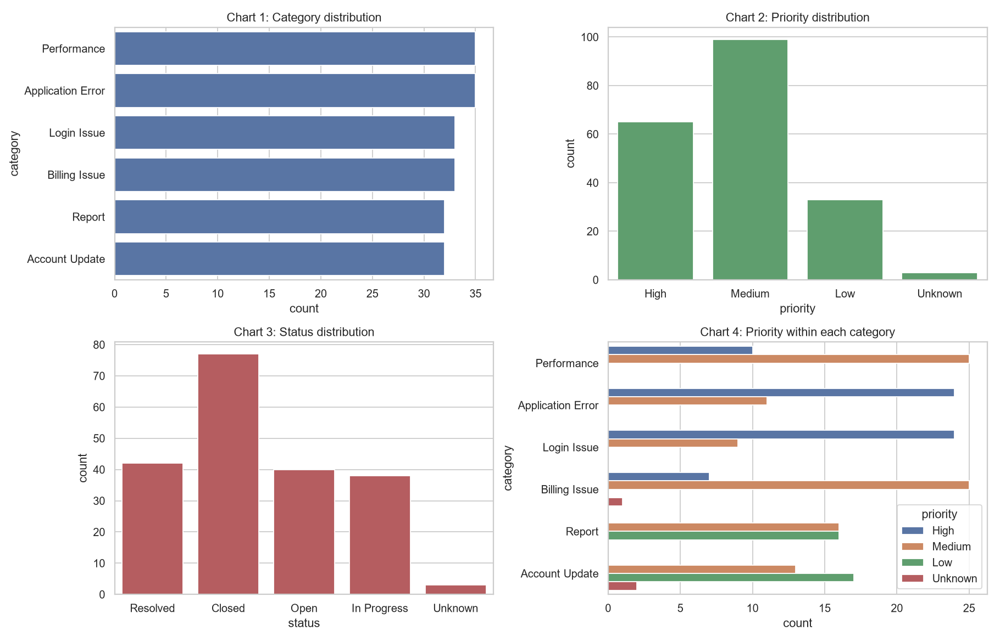
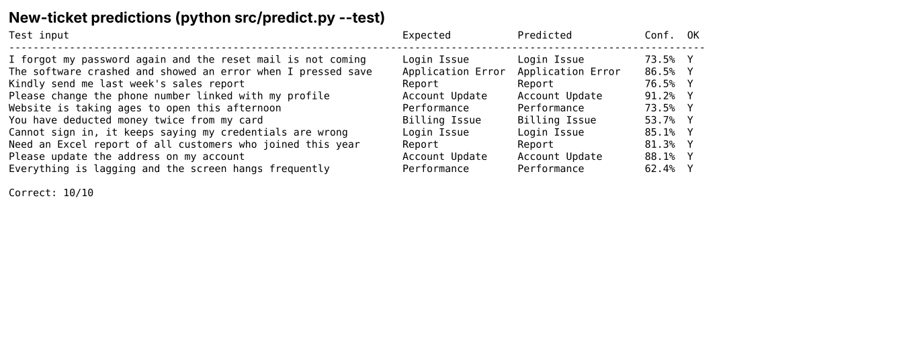

# A. Problem Understanding
A company gets many support requests by email and chat. Reading and sorting each one by hand is slow and
inconsistent. The goal is to build a basic ML system that reads the **description** of a new ticket and
predicts its **category** (for example *Login Issue* or *Performance*), so tickets can be routed to the right team.
This is a **text classification** problem: text in, one of several labels out.

# B. Dataset
* **Source:** created by me (no external dataset). Ticket descriptions were written to look like real requests
  (formal, casual, short, with typos). Script: `src/generate_dataset.py`.
* **Records:** 208 raw rows → **200** after cleaning.
* **Categories (6):** Login Issue, Application Error, Report, Account Update, Performance, Billing Issue
  (about 32–35 tickets each).
* **Fields:** `ticket_id`, `ticket_description`, `category`, `priority`, `status`.
* **Deliberate difficulty:** 10 tickets mix vocabulary of two categories (e.g. "Report takes too long to generate"
  is *Performance*, not *Report*). 6 duplicates, 12 messy-text rows and 8 missing values were added to practise cleaning.

# C. Data Preprocessing
| Problem | What I did | Why |
|---|---|---|
| Missing `ticket_description` (2 rows) | Dropped the rows | Nothing to learn from without text |
| Missing `priority` / `status` (3 each) | Filled with "Unknown" | Not model inputs; keeps the row for EDA |
| Duplicate tickets (6 rows) | Removed after text cleaning (same text + category) | Duplicates can land in both train and test and inflate accuracy |
| Messy text (CAPS, spaces, `!!`) | Lowercase, remove punctuation, collapse spaces | "Slow" and "SLOW!!" must be the same word |

Stop-words such as *not* and *cannot* were **kept**, because "password reset is **not** working" depends on them.
Tokenisation is done inside the TF-IDF vectoriser.

# D. Model Selection
**Pipeline:** Ticket text → cleaning → TF-IDF (1-word and 2-word phrases) → Logistic Regression → category + probability.

* **Features:** TF-IDF turns each ticket into a vector. Each number says how important a word or two-word phrase is
  in that ticket (frequent in the ticket, rare across all tickets = high weight). Bigrams such as "too long" or "not working"
  help capture meaning.
* **Algorithm:** Logistic Regression. It learns one weight per word per category and picks the category with the highest
  probability. I chose it because it is simple, explainable (I can list the top words per category), fast on small data,
  and gives the **confidence score** needed for the interface.
* **Compared with** Naive Bayes and Linear SVM using 5-fold cross-validation on the training data only
  (macro F1: Naive Bayes 0.77, Linear SVM 0.80, Logistic Regression 0.80). The three are close; Logistic Regression
  was kept for the probability output and simplicity.

Top words the model learned: Login → *password, login, sign, reset*; Performance → *slow, takes, slowly, load*;
Billing → *payment, invoice, charged*; Report → *report*; Account Update → *change, update, profile*; Application Error → *error*.

# E. Training and Testing
* Split: **80 % train (160 tickets) / 20 % test (40 tickets)**, stratified so every category appears in both.
* Training: fit the TF-IDF + Logistic Regression pipeline on the 160 training tickets.
* Testing: the 40 unseen tickets were used **once**, after the model was chosen.
* For deployment the final model was re-trained on all 200 tickets (standard practice after evaluation).

# F. Results
| Metric (test set, macro average) | Value |
|---|---|
| Accuracy | **95.0 %** |
| Precision | 0.955 |
| Recall | 0.952 |
| F1 score | 0.950 |

**In simple words:** 38 of 40 unseen tickets were classified correctly. Performance and Report were perfect.

{width=60%}

The 2 mistakes:

1. *"there is a bug, the total amount is calculated wrong on the invoice screen"* → predicted Billing Issue (actual Application Error). The words "total", "amount", "invoice" look like billing.
2. *"my account is locked after too many failed attempts"* → predicted Account Update (actual Login Issue). The word "account" misled it.

**Is this satisfactory?** For a first version, yes. But I would not over-trust the 95 %: the test set is only 40 tickets
(one ticket = 2.5 %), and the cross-validation score on the training data was lower (about 0.80 macro F1). The honest range
is somewhere around 80–95 %, and the real-world figure would likely be lower because real tickets are messier than my dataset.

## Exploratory data analysis
Total tickets: 200. Priority: Medium 99, High 65, Low 33, Unknown 3. Status: Closed 77, Resolved 42, Open 40, In Progress 38, Unknown 3.

**Observations**

* Categories are almost perfectly balanced (32–35 each), so plain accuracy is a fair metric and no re-balancing was needed.
  A real company would have a skewed distribution.
* Priority is strongly tied to category in this dataset (Login and Application Error are mostly High; Report and Account Update are never High).
  This is an artefact of how I created the data, not a real-world finding.
* Tickets are short (5–14 words, mean 8.7), so there is little text for the model to use.

# G. Prediction on New Tickets
10 new tickets, written after training and **not present in the dataset**:

| Test input | Expected | Predicted | Confidence |
|---|---|---|---|
| I forgot my password again and the reset mail is not coming | Login Issue | Login Issue | 73.5 % |
| The software crashed and showed an error when I pressed save | Application Error | Application Error | 86.5 % |
| Kindly send me last week's sales report | Report | Report | 76.5 % |
| Please change the phone number linked with my profile | Account Update | Account Update | 91.2 % |
| Website is taking ages to open this afternoon | Performance | Performance | 73.5 % |
| You have deducted money twice from my card | Billing Issue | Billing Issue | 53.7 % |
| Cannot sign in, it keeps saying my credentials are wrong | Login Issue | Login Issue | 85.1 % |
| Need an Excel report of all customers who joined this year | Report | Report | 81.3 % |
| Please update the address on my account | Account Update | Account Update | 88.1 % |
| Everything is lagging and the screen hangs frequently | Performance | Performance | 62.4 % |

10 / 10 correct. Caveat: I wrote these in a style similar to the training data, so this is an easier test than real tickets.
Confidence for the correct answers is only 54–91 %, which is normal with a small dataset.

**Bonus (rule-based replies):** each predicted category has a template reply, e.g. Login Issue → *"Please use the Forgot Password option on the login page to reset your password…"*. No external AI API is used.

**Interfaces:** command line (`python src/predict.py`) and Flask web app (`python src/app.py`).

# H. Limitations
* **Small, synthetic dataset** (200 tickets written by one person): the model learns my wording, not real customers' language.
* **Ambiguous or overlapping tickets** are risky. Examples I tried: "I want to know why my report is slow" → Performance (35 % confidence);
  "Please refund my payment and delete my account" → Account Update (60 %), although it contains two requests.
* **No "unknown" option:** gibberish such as "hello" is still forced into a category (Performance, 20 % confidence). A confidence threshold
  that sends low-confidence tickets to a human would fix this.
* **One label per ticket**, while real tickets often have several issues.
* **Single short test set** (40 tickets), so the metrics are noisy.
* English only; no handling of Hindi/Bengali or mixed-language text.

# I. Future Improvements
* Collect a much larger set of **real, labelled tickets** and check label quality with more than one reviewer.
* Add a **confidence threshold** and a human-review queue for uncertain tickets; use agent corrections as new training data (continuous retraining).
* Try better text features (e.g. sentence embeddings) or a fine-tuned transformer / LLM-based classifier, and compare with this baseline.
* Support multi-label tickets and more categories.
* Serve the model through a production API (FastAPI), store tickets in a database, and monitor accuracy over time.

# Tools, libraries and AI usage
Python, pandas, NumPy, scikit-learn, matplotlib, seaborn, joblib, Flask.
**AI assistance:** Claude (Anthropic) was used to help draft the code, the synthetic dataset and this report.
No AI API is called by the submitted program, and no keys or credentials are included.
